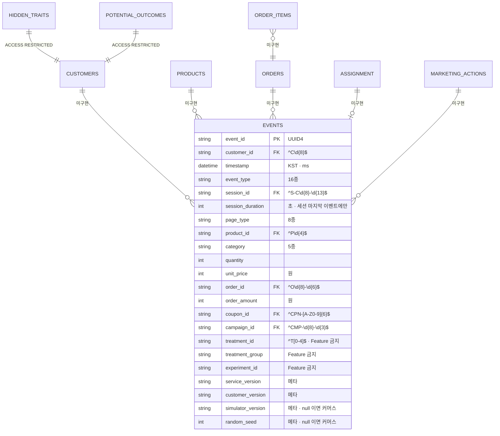
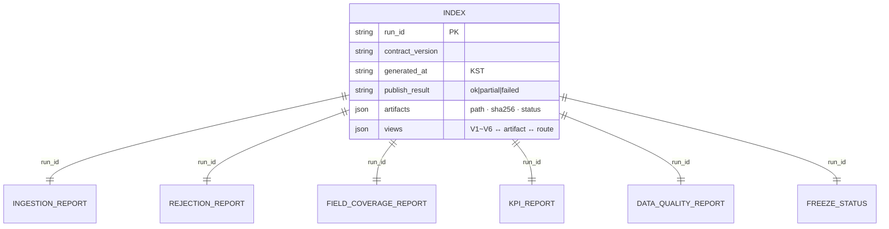

# 데이터 모델 · ERD

**작성** James (Role 4 · Architect) · 2026-09-11 · 사이클 C1
**정본 근거** SRS `DATA-003` · `docs/data_spec.html` §7 · §15.1 · §17.4 · `src/measurement/schema.py` (실측)

> **C1 에 구현된 테이블은 `events` 하나다.** 나머지는 정본이 요구하지만 존재하지 않는다.
> 이 문서는 **있는 것과 없는 것을 같은 그림에 그린다** — 없는 것을 그림에서 빼면 "다 있다"로 읽힌다.

---

# 1. 전체 그림



## 1.1 테이블 현황 — 정본 대비 실측

| 테이블 | 경로 (`data_spec` §7.1) | 예상 행 | C1 구현 | 근거 |
|---|---|---|---|---|
| **`events`** | `data/raw/` | ≈ 25,000,000 | ✅ | `sink.py:191` |
| `customers` | `data/raw/` | 26,000 | ❌ | `sink.py:191` 은 `events` 만 |
| `orders` | `data/raw/` | ≈ 620,000 | ❌ | 동일 |
| `order_items` | `data/raw/` | ≈ 4,300,000 | ❌ | 동일 |
| `products` | `data/raw/` | 240 | ❌ | 동일 |
| `marketing_actions` | `data/raw/` | ≈ 10,200 | ❌ | 동일 |
| `assignment` | `data/raw/` | ≈ 20,400 | ❌ | 동일 |
| `hidden_traits` | `data/hidden/` | 26,000 | ❌ | **measurement 는 참조조차 금지** |
| `potential_outcomes` | `data/ground_truth/` | ≈ 20,400 | ❌ | **`diagnostics` 전용** |
| `features_t0` · `labels` | `data/processed/` | ≈ 20,400 | ❌ | `decision` 소관 |

> **미구현 6종이 만드는 것 (W1 D-4 · `#44` OPEN 사유 1):**
> - 참조 무결성 검사 불가 (`DQ-03`) · `signup_date` 검사 불가 (`DQ-05`)
> - **금액 정합성 검사 원리적으로 불가** (`DQ-09` — `order_items` 필요)
> - `EVENT SCHEMA v1` Lock 범위를 `events` 로 한정해야 하는 이유 (`gate1-lock-scope.md` §4.8)

---

# 2. `events` — 22 컬럼

`tests/test_schema.py:61-72` 가 **`assertEqual` 로 정확히 22종을 고정**한다(부분집합이 아니다). 컬럼을 늘리는 것은 SRS `DATA-003` 변경이며 `Plan/` 수정 = 권한 밖이다.

| 그룹 | 컬럼 | 필수 판정 |
|---|---|---|
| **core** (4) | `event_id` · `customer_id` · `timestamp` · `event_type` | **항상 REQUIRED** |
| **session** (3) | `session_id` · `session_duration` · `page_type` | 이벤트별 |
| **product** (4) | `product_id` · `category` · `quantity` · `unit_price` | 이벤트별 |
| **order** (2) | `order_id` · `order_amount` | 이벤트별 |
| **marketing** (5) | `coupon_id` · `campaign_id` · `treatment_id` · `treatment_group` · `experiment_id` | 뒤 3종은 **어디서나 OPTIONAL** |
| **meta** (4) | `service_version` · `customer_version` · `simulator_version` · `random_seed` | **항상 OPTIONAL** |

## 2.1 `NOT_APPLICABLE` 이 화이트리스트로 동작한다

`schema.py:251-262` — `_EVENT_RULES` 에 없는 필드는 자동으로 `NOT_APPLICABLE` 이고, **값이 있으면 거부된다**(`schema.py:293-297`).
→ `push_sent` 에 `product_id` 를 붙이면 위반이다.

**이 설계가 스키마 공백을 드러낸다** — 값을 붙일 자리가 없으면 그 정보는 존재할 수 없다. §5 의 세 공백이 그렇게 발견됐다.

## 2.2 메타 4종이 OPTIONAL 인 이유 — 출처 판별

```python
simulator_version is None and random_seed is None  →  COMMERCE
그 외                                              →  SIMULATOR
```

`sink.py:74-83`. `MEA-002` 를 **별도 플래그 컬럼 없이 스키마에서 파생**한다 → 기록자가 출처를 위조할 여지가 적다.

> ⚠ `data_spec` §7.2 는 메타 4종을 `Nullable = N` 으로 적었다(W1 D-1). **코드가 옳다** — null 을 출처 판별에 쓰는 것이 `MEA-002` 다. `data_spec` 이 낡았다.

## 2.3 파생 상태는 `events` 에 들어갈 수 없다

`DerivedStateType`(`inactive`·`at_risk`·`churn`)은 `EventType` **밖**의 별도 Enum 이다(`schema.py:66-76`). 교집합이 없음을 `test_schema.py:49-53` 이 강제한다.

> **설계 공백 (W1 D-7):** PRD §30.2 · `data_spec` §7.3 은 *"기록은 하되 Feature 금지"* 를 요구하는데, **`EventType` 밖이라 Sink 에 기록할 수단 자체가 없다.**
> `EventType` 에 3종을 넣으면 `test_schema.py:45-47` 이 고정한 16종이 19종이 된다 — `EVENT SCHEMA v1` 의 실질 변경이다.
> **→ `#45`(M-3) Lock 최종 검산에서 결론을 낸다.** 아키텍처가 먼저 정하면 그 검산을 건너뛰는 것이 된다.

## 2.4 이 계층을 통과할 수 없는 필드 25종

`FORBIDDEN_FIELD_NAMES`(`schema.py:149-159`) — Hidden Trait 14종 + 생성 라벨·정답 11종.
**3중 방어:** 스키마에 없음(`test_schema.py:78-81`) → 런타임 거부(`schema.py:285-287`) → 저장 차단(`test_sink.py:138-143`).

> ⚠ **거부된 레코드는 `rejected.jsonl` 에 원문으로 남는다.** 그 파일을 `results/` 로 옮기면 금지 필드가 대시보드까지 가는 경로가 생긴다.
> → **게시물은 집계와 화이트리스트 필드만 담는다** (`api-contracts.md` §5.2).

---

# 3. 저장 배치

```text
data/raw/                              ← Event Sink root
├── events/
│   └── date=YYYY-MM-DD/               ← 날짜 단일 파티션 (sink.py:190-197)
│       └── part-NNNN.{parquet|jsonl.gz}
├── manifest.json                      ← 무엇이 들어왔고 무엇이 비었는가
└── rejected.jsonl                     ← 거부분 (있을 때만) ★ 금지 필드가 남는다

data/processed/   Feature · 라벨              [decision 소관 · C1 미사용]
data/hidden/      Hidden Trait                [simulator · diagnostics 만]
data/ground_truth/ Potential Outcome          [diagnostics 전용]

results/
├── data_quality_report.json           ← V5 · data_spec §9 지정 경로
└── measurement/                       ← 측정 계층 게시 영역
    └── index · ingestion · rejection · field_coverage · kpi · freeze_status
```

## 3.1 파티션 — 날짜 하나. 출처로 나누지 않는다

`sink.py:190-197` 은 `date=YYYY-MM-DD` 만 쓴다. **출처(commerce/simulator)로 파티션을 나누지 않는다.**

| | |
|---|---|
| 결과 | 저장 레코드에 출처가 남지 않는다 (W1 W-7·W-10) |
| **C1 의 해법** | **게시 시점에 `event_source()` 로 분해해 `by_source` 로 게시한다.** 대시보드가 재분류하지 않는다 |
| 파티션을 나누지 않는 이유 | 출처는 **스키마에서 파생되는 값**이지 저장 키가 아니다. 파티션 키로 승격하면 되돌리기 어렵고, `date` 만으로도 게시 집계가 성립한다 |

## 3.2 ⚠ 알려진 결함 — 파티션 덮어쓰기 (`#53` D1-1)

`_part_index` 가 인스턴스마다 새 `Counter` 다(`sink.py:146`). **같은 root 에 두 번 쓰면 `part-0000` 을 덮어쓴다.**
`sink.py:113` 독트링은 *"append 한다"* 고 적혀 있으나 사실이 아니다.

> **데이터 소실형 결함이다.** `data/raw` 에 쌓인 뒤 고치면 사라진 것은 돌아오지 않는다.
> → `gate1-lock-scope.md` §2.3 이 `#53` 을 **Phase 1** 에 둔 이유이며, ERD 관점에서도 **데이터 생성 이전에 닫아야 하는 유일한 결함**이다.

---

# 4. 게시물의 데이터 모델

게시물은 테이블이 아니라 **문서**다. 관계는 `run_id` 로 맺는다.



| 관계 | 강제 |
|---|---|
| `run_id` 가 전 게시물에서 같다 | 읽는 쪽이 확인한다 (`api-contracts.md` §6.2) |
| `artifacts[].path` 가 `results/`·`data/processed/` 아래 | **스키마 정규식**이 강제한다 |
| `views` 가 V1~V6 전부를 갖는다 | 스키마 `required` |
| `provenance` 가 전 게시물에 있다 | 스키마 `required` (`DB-013`) |

**`run_id` 는 조인 키가 아니라 정합성 키다.** 여러 run 을 함께 두지 않는다(최신 1벌만). 이력이 필요해지면 `results/measurement/history/<run_id>/` 로 확장할 수 있게 열어 두었다.

---

# 5. ★ 스키마 공백 3건 — 계산식이 요구하는데 필드가 없다

세 건 모두 **"기여이익식이 빼는 항목"** 이라는 공통점이 있다. 우연이 아니라 **경제 모델이 스키마보다 나중에 정해진 결과**다.

| # | 없는 것 | 못 하는 것 | 발견 | 결정 |
|---|---|---|---|---|
| **A-0** | 배송비·배송보조 필드 | `shipping_subsidy` 계산 | Joshua (`kpi-definition-v1.md` §5.4) | **D-3** |
| **A-1** | `discount` 필드 | `coupon_cost` 계산 · **금액 정합성 검사** | 이 웨이브 (`api-contracts.md` §8) | **D-16** |
| **A-2** | 환불·취소 이벤트 | 순매출 산출 (총매출을 순매출로 간주) | Caleb → Joshua (`economic-rule-v1.md` §6) | **D-2** |

## 5.1 공통 구조

```
data_spec §6.3 기여이익식
  = revenue − cogs − coupon_cost − shipping_subsidy − message_cost − campaign_fixed_cost/N

     revenue          ← order_amount        ✅ 있다
     cogs             ← unit_cost           ❌ 커머스에 없다   (Ecommerce #24)
     coupon_cost      ← discount            ❌ 스키마에 없다   (A-1)
     shipping_subsidy ← 배송비               ❌ 스키마에 없다   (A-0)
     message_cost     ← push_sent 건수      ✅ 있다
     campaign_fixed   ← 캠페인 수 · N        ✅ 있다
```

**여섯 항목 중 셋이 계산 불가다.** 그래서 `contribution_profit` 은 오늘 어떤 출처에서도 나오지 않는다.
**이것을 0 으로 채우면 `contribution_profit == revenue` 가 되고, PRD §65 가드레일이 죽는다.** 게시 계약이 `null` 을 강제하는 이유다.

## 5.2 셋 다 같은 제약을 공유한다

**필드를 추가하려면 SRS `DATA-003` 을 고쳐야 하고, 그것은 `Plan/` 수정 = 이 팀의 권한 밖이다.**
`tests/test_schema.py:61-72` 의 `assertEqual(22)` 와 `:45-47` 의 `assertEqual(16종)` 이 우회도 막는다.

**→ 셋 다 "규칙 유도값(`derived: true`) 또는 계산 불가"로 처리하고, 그 사실을 산출물에 남긴다.** 그것이 권한 안에서 할 수 있는 최선이고, 감추지 않는 유일한 방법이다.

---

# 6. 데이터 경로 경계 (`ISO-003` · `DB-014`)

| 경로 | measurement | simulator | decision | diagnostics | **dashboard** |
|---|---|---|---|---|---|
| `data/raw/` · `data/processed/` | ✅ | ✅ | ✅ | ✅ | **❌** |
| `data/hidden/` | **❌ 강제** | ✅ | ❌ 강제 | ✅ | ❌ |
| `data/ground_truth/` | **❌ 강제** | ❌ | ❌ 강제 | ✅ | ❌ |
| `results/` | **쓰기** (§1 근거) | ❌ 강제 | ✅ | — | **읽기 전용** |

**"강제"** = `tests/test_isolation.py` 가 문자열 검사로 실패시킨다.
**대시보드 행은 강제되지 않는다** — W-8. 검사 확장 설계는 `dashboard-architecture.md` §6.

> **`.gitignore` 를 격리 수단으로 쓰지 않는다** (`data_spec` §17.4). `data/` 를 ignore 하는 것은 저장소 반영을 막을 뿐 런타임 접근을 막지 못한다.
