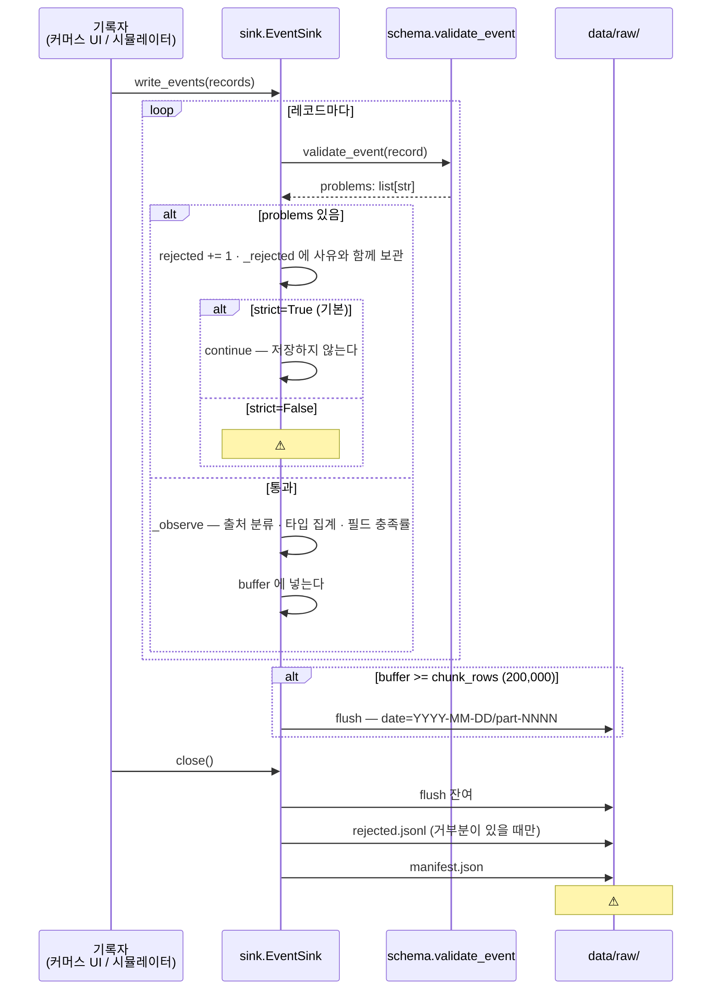
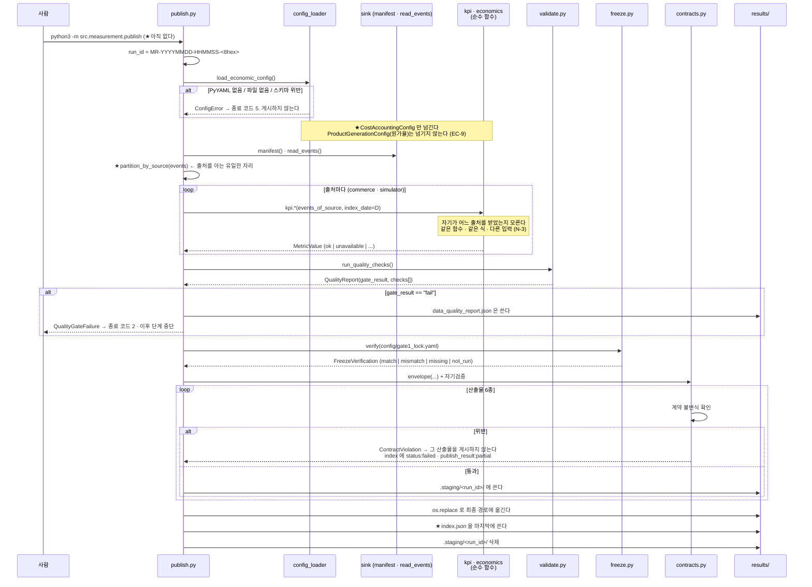
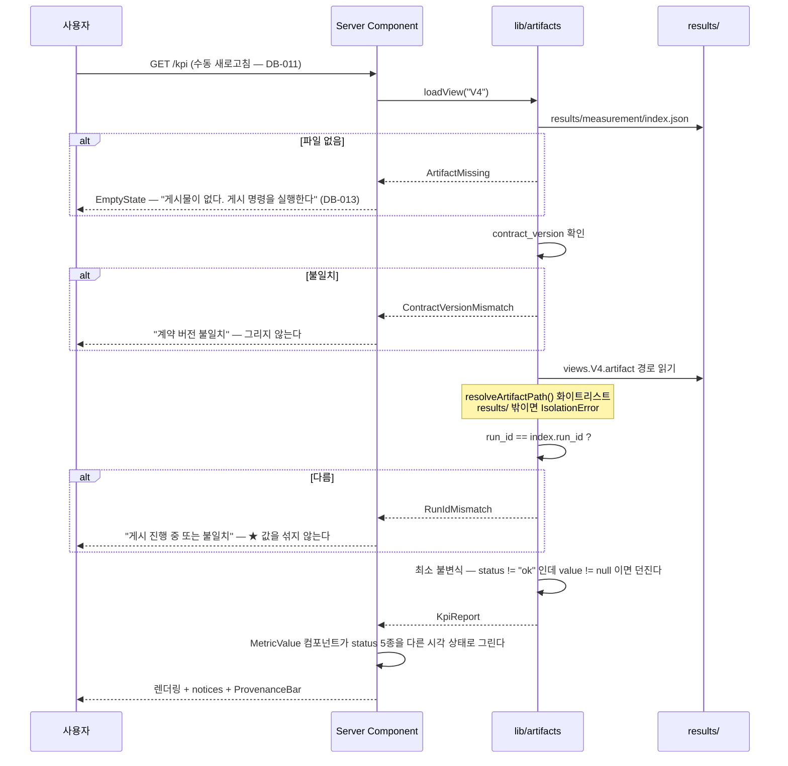
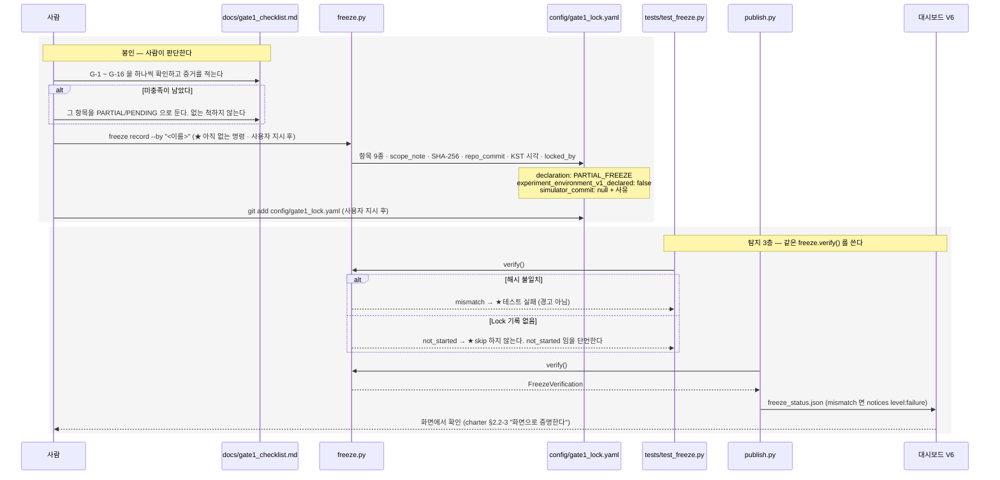

# 서비스 시퀀스

**작성** James (Role 4 · Architect) · 2026-09-11 · 사이클 C1

> C1 의 실행 경로는 넷이다. **각 시퀀스의 실패 분기를 함께 그린다** — 정상 경로만 그린 시퀀스는 설계가 아니다.

---

# S-1 · 이벤트 수집 (구현됨)

| 결함 | 영향 | 이슈 |
|---|---|---|
| D1-1 파티션 덮어쓰기 | **데이터 소실.** 데이터 생성 전에 고쳐야 한다 | `#53` |
| D1-2 `strict=False` 크래시 | `MEA-003` 정면 충돌 — 결손 관용 경로가 죽는다 | `#53` |
| D1-3 타임존 미강제 | UTC 가 통과하고 **파티션 날짜가 하루 어긋난다** → 코호트·리텐션 왜곡 | `#53` |

---

# S-2 · ★ 게시 (신설 · T2.7)

## S-2 의 설계 요점 넷

| # | 요점 |
|---|---|
| **①** | **출처를 아는 자리는 `partition_by_source` 한 줄뿐이다.** 계산 함수는 출처를 모른다 → 창구 중립성이 구조로 유지된다 (`code-structure.md` N-3) |
| **②** | **`index.json` 을 마지막에 쓴다.** 읽는 쪽이 인덱스를 먼저 읽으므로, 인덱스가 없거나 옛것이면 부분 게시 상태를 보지 않는다 |
| **③** | **`fail closed`.** 자기 스키마를 통과하지 못한 산출물은 게시하지 않는다. 잘못된 값은 화면에서 정상으로 보이지만, 없는 파일은 없다고 보인다 |
| **④** | **품질 게이트 `fail` 은 게시를 멈추되 품질 리포트는 남긴다.** 왜 멈췄는지가 화면에 있어야 한다 |

---

# S-3 · 대시보드 읽기

**대시보드가 계산하지 않는다** (`DB-012`) — 합계·비율·출처 분류·계산 불가 판정이 **전부 게시 시점에 끝나 있다.**

---

# S-4 · GATE 1 부분 봉인과 대조

> **이 시퀀스가 막지 못하는 것:** *"결과를 본 뒤 시뮬레이터를 고치는 것"*.
> 해시는 **바뀌었다**를 알려줄 뿐 **왜**를 모른다. 성능이 나쁘다고 고치고 다시 Lock 하면 대조는 통과한다.
> 막는 것은 `FREEZE-002`·`FREEZE-003` 절차와 `git log config/gate1_lock.yaml` 에 남는 재봉인 이력이다. → `gate1-freeze-procedure.md` §4.5

---

# S-5 · 실패 경로 한 표

| # | 실패 | 어디서 | 결과 |
|---|---|---|---|
| F-1 | 스키마 위반 레코드 | `validate_event` | 거부 + `rejected.jsonl` → **V2 에 집계로 보인다** |
| F-2 | `timestamp` 해석 실패 | `_partition_key` | `ValueError` — **조용히 넘기지 않는다** (`sink.py:277-279`) |
| F-3 | config 없음/위반 | `config_loader` | `ConfigError` → 종료 5 · **게시하지 않는다** |
| F-4 | 품질 검사 위반 | `validate.py` | `QualityGateFailure` → 종료 2 · 품질 리포트는 남긴다 |
| F-5 | 산출물이 자기 스키마 위반 | `contracts.py` | `ContractViolation` → 그 산출물만 미게시 · `partial` |
| F-6 | 봉인 해시 불일치 | `freeze.verify` | 게시하되 `notices level:failure` · **테스트는 실패** |
| F-7 | 게시물 없음 | 대시보드 | **게시 방법 안내** (`DB-013`) |
| F-8 | `run_id` 불일치 | 대시보드 | 불일치 표시 · **값을 섞지 않는다** |
| F-9 | 허용 경로 밖 읽기 | `lib/artifacts` | `IsolationError` — 런타임 방어 |
| F-10 | pyarrow 없음 | `sink.resolve_format` | `jsonl.gz` 폴백 + **`DQ-17` 을 `blocked` 로 게시** |

전체 분류·종료 코드·처리 규칙은 `exceptions.md`.
